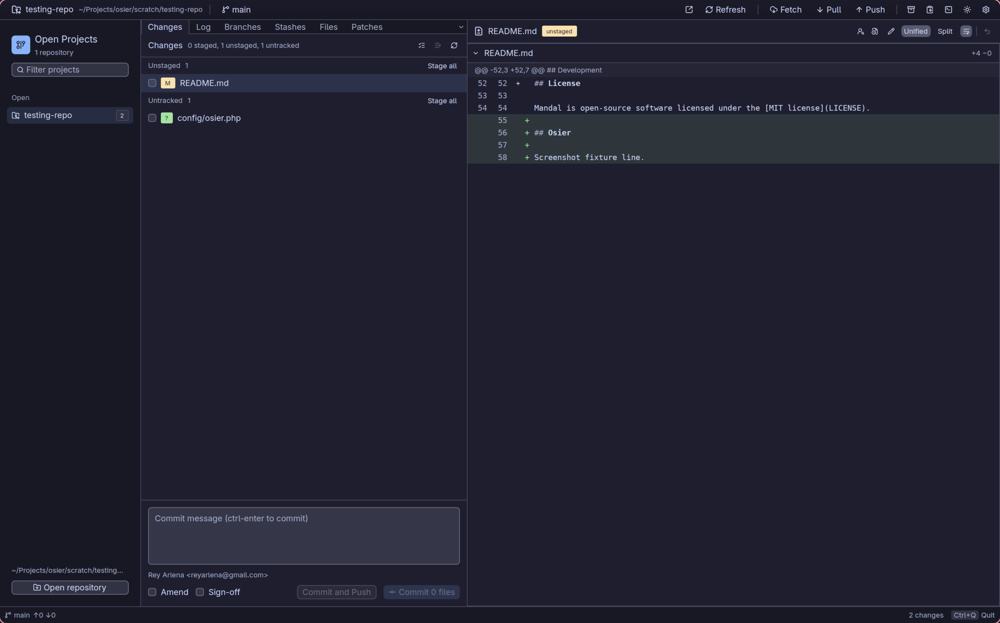
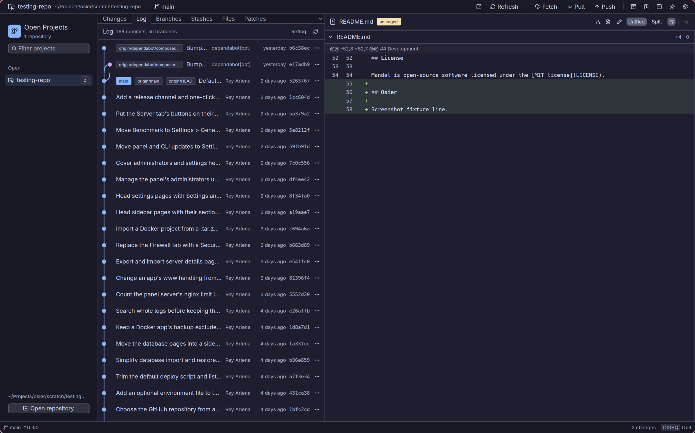
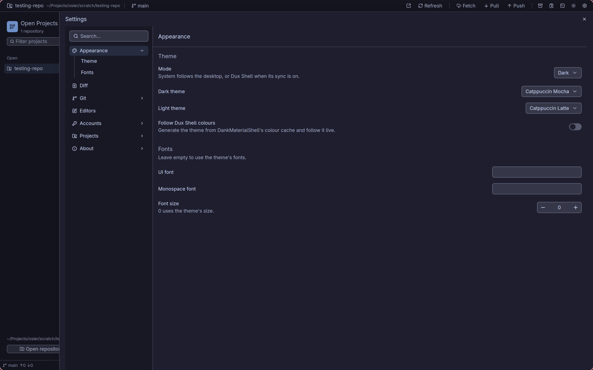

# Osier

[](https://github.com/ReyArlena/osier/actions/workflows/ci.yml)
[](https://github.com/ReyArlena/osier/releases)
[](LICENSE)
[](#install)
[](https://www.rust-lang.org/)
[](https://reyarlena.github.io/osier/)

A fast, native git GUI for Linux. Built in Rust on [gpui](https://www.gpui.rs/) through
[gpui-kit](https://github.com/longbridge/gpui-kit), with the git workflow of a JetBrains IDE and
none of the IDE.



## Features

- **Visual staging**: stage, unstage and discard whole files, single hunks or selected lines
  from the diff; untracked files go to the trash, never `rm`.
- **Commit log with graph**, tags and branch labels, reflog, compare any two refs, file
  history (`log --follow`) and blame with a click through to the commit.
- **Branches, tags, remotes, worktrees, submodules, stashes** in one place, with the usual
  create/rename/delete/checkout actions and confirmations where data could be lost.
- **Fetch, pull, push** with progress and cancel, upstream prompts, pull strategy memory per
  repository, `--force-with-lease` only (never plain `--force`).
- **Update project**, like PhpStorm's: fetch, then merge or rebase (asked, or remembered per
  repository), with uncommitted changes set aside and put back, stopping only for real
  conflicts. Remembered choices are listed in Settings > Projects > Per-project choices.
- **Merge, rebase, cherry-pick, revert, interactive rebase, squash** with conflicts resolved in place:
  accept current / incoming / both per block, or edit the result directly.
- **Three-way merge tool**, like PhpStorm's: yours, the result and theirs side by side, with
  apply / ignore on each change, "apply non-conflicting changes", word highlights and the
  panes scrolling together. Expand it to the whole window, or use it from the terminal as
  git's `mergetool` (and Osier's diff view as `difftool`).
- **Patches**: copy files or commits as a patch, apply from clipboard or file with a dry run
  and a three-way fallback, and a patch clipboard that shelves changes and carries them
  between projects.
- **Clone and create**: clone any repository a gh account can reach (or any address), or
  create one on GitHub with GitHub's own options (template, README, .gitignore, licence)
  and open it straight away.
- **Multiple GitHub accounts** through the [gh CLI](https://cli.github.com/): pick an account
  per project, remember it, and never let a token touch the command line or a log.
- **Files tab** with code, markdown (rendered or source) and image viewing at any revision.
- **Themes**: Catppuccin Mocha and Latte, your own gpui-kit theme files, and optional live
  colours from [Dux Shell](https://github.com/AvengeMedia/DankMaterialShell).
- **Everything is visible**: a log of every git command Osier runs, an operation history,
  and a command palette for every action.



## Install

Osier needs Linux (Wayland, X11 fallback), `git` 2.30 or newer and a GPU driver with Vulkan.

**Script** (prebuilt binary for x86_64 and ARM64 Linux with glibc 2.35 or newer; other
systems get pointed to the source build below). `osier --update`, or Settings > About >
Updates, installs new releases the same way:

```sh
curl -fsSL https://raw.githubusercontent.com/ReyArlena/osier/main/install.sh | sh
```

<!-- Reinstate when the AUR packages are published:
**Arch Linux**: PKGBUILDs for `osier` and `osier-bin` live in `packaging/aur/` until the
packages are on the AUR.
-->

**From source**:

```sh
# Debian/Ubuntu build deps:
#   pkg-config libxkbcommon-dev libxkbcommon-x11-dev libxcb-xkb-dev libwayland-dev \
#   libvulkan-dev libfontconfig1-dev libssl-dev
# Arch: pkgconf libxkbcommon libxkbcommon-x11 wayland vulkan-headers fontconfig openssl
cargo install --locked --git https://github.com/ReyArlena/osier osier
```

For a launcher entry and icon after a source build, copy them from a clone of the
repository (the entry runs `osier`, so `~/.cargo/bin` must be on your `PATH`):

```sh
install -Dm644 packaging/com.reyarlena.osier.desktop -t ~/.local/share/applications
for s in 16 32 48 64 128 256 512; do
  install -Dm644 packaging/icons/hicolor/${s}x${s}/apps/com.reyarlena.osier.png \
    -t ~/.local/share/icons/hicolor/${s}x${s}/apps
done
```

<!-- Reinstate when the Flatpak is published:
A Flatpak manifest draft is in `packaging/flatpak/`.
-->

## Usage

```
osier [path]          open a repository (or start with the last session); if Osier is
                      already running, it opens the repository there and comes to the front
osier -n [path]       start a separate window instead (--new-instance)
osier --update        install the latest release (installs from the install script;
                      --check only reports, --force reinstalls)
osier --version --verbose
osier merge <left> [<base>] <right> <output>
                      merge two versions of a file in a window of its own and write the
                      result to <output> (exit 0 after Apply, 1 on Cancel)
osier diff <left> <right>
                      compare two files in a window of its own
```

Installed with a package manager, Flatpak or cargo? Update it that way; `osier --update`
says so. Settings > About shows how Osier was installed.

Open repositories from the sidebar (`ctrl-shift-o`), or let Osier scan directories for them
(Settings > Projects). `ctrl-o` switches project: it searches the open, pinned and recent
projects in the command palette. Useful keys: `ctrl-1`..`ctrl-6` switch tabs, `ctrl-enter` commits,
`ctrl-t` updates the project, `ctrl-shift-f/l/p` fetch/pull/push, `` ctrl-` `` shows the git command log, `ctrl-p` or
`F1` opens the command palette, `ctrl-,` opens settings, `/` searches projects, `?` searches
files (Esc clears a search). Plain keys like `/`, `j` or space never fire while you type in a
text field.

The project filter also takes `is:changed` (uncommitted changes), `is:ahead` (unpushed
commits) and `is:behind` (new commits on the remote), alone or with a name: `is:ahead api`.
Clicking the filter lists them. Projects that are not open only match when Settings >
Projects > Show status is on.

Every shortcut can be changed in Settings > Keymap or in `~/.config/osier/keymap.toml`, which
holds only your changes and is reloaded when it changes:

```toml
[bindings]
refresh = ["f5"]                      # replaces ctrl-r and f5
focus_project_search = ["/", "ctrl-f"]
open_settings = []                    # unbound
prefix_key = ["ctrl-h"]               # a leader key (unset by default)
focus_file_search = ["prefix ?"]      # only after the prefix: ctrl-h, then ?
tab_log = ["prefix? l"]               # either: l alone, or ctrl-h then l
row_add_to_gitignore = ["i"]          # context menu entry on the selected row
```

**Prefix key.** Press it, then a binding's key. While it waits the status bar shows "Prefix
key pressed"; Escape, a click, an unbound key or the timeout (5 seconds by default) cancel it.
Each key is set to No prefix, Prefix only or Either with three buttons on the Keymap page, and
keys after the prefix also work while typing in a text field.

**Context menus.** Every right-click entry (Add to .gitignore, Delete / Drop, Cherry-pick, ...)
can have a key that runs it on the selected row of Changes, Files, Log, Branches, Stashes or
Patches, and the menus show each entry's key. These keys start unbound and cannot share a key
with any other binding.

If you use Dux Shell (DankMaterialShell), Osier writes its shortcuts to
`~/.config/dms/cheatsheets/osier.json`, so `dms keybinds show osier` and the DMS keybinds
overlay list them.



### Merge tool

Pick **3-way** at the top of the diff pane (or `diff.mode = "three-way"` in the config) and
conflicted files open in the merge tool: your version on the left, the result in the middle
and theirs on the right. During a rebase the left side is still your commit and the right
side is the branch you are rebasing onto.

- `>>` / `<<` beside a change copies it into the result; `X` ignores it. Applying the second
  side of a conflict adds it below the first.
- **Apply non-conflicting changes**: Left, All or Right takes every change that does not
  clash in one go.
- The result is an ordinary editor: type in it freely, the changes move with your edits.
- `F7` / `shift-F7` jump to the next / previous change; the gear menu has synchronised
  scrolling, whitespace handling and word highlighting.
- **Accept Left** / **Accept Right** use one side for the whole file. **Save** writes the
  result and leaves the file conflicted; **Apply** (`ctrl-enter` in the result) writes it and
  marks it resolved (it asks first if changes are still undecided).
- The expand button (or `ctrl-shift-m`) hides the sidebar and file list; `Esc` brings them
  back. While expanded, arrows step through the conflicted files and Apply moves on to the
  next one.
- Other files show the split diff while 3-way is selected.

### git mergetool and difftool

`osier merge` and `osier diff` open a window of their own, without a repository, and git
waits for it to close. Register them once:

```sh
git config --global merge.tool osier
git config --global mergetool.osier.cmd 'osier merge "$LOCAL" "$BASE" "$REMOTE" "$MERGED"'
git config --global mergetool.osier.trustExitCode true
git config --global mergetool.keepBackup false

git config --global diff.tool osier
git config --global difftool.osier.cmd 'osier diff "$LOCAL" "$REMOTE"'
git config --global difftool.prompt false
```

Then `git mergetool` opens each conflicted file in turn: Apply writes the result and git marks
the file resolved, Cancel (or closing the window) leaves it conflicted. `git difftool` shows
each changed file. With `trustExitCode` git believes Osier's exit code instead of asking
whether the merge worked.

Any two files work too, from anywhere, with or without a common ancestor:

```sh
osier merge mine.conf original.conf theirs.conf merged.conf
osier merge a.txt b.txt result.txt     # no base: every difference is a conflict
osier diff old.json new.json
```

A file literally named `merge` or `diff` in the current directory opens as a path with
`osier ./merge`.

## Configuration

Settings live in `~/.config/osier/config.toml` and are safe to keep in dotfiles: the file is
re-read when it changes. Every key is optional.

```toml
[appearance]
high_contrast = false         # stronger selection and hover colours
mode = "system"               # dark | light | system (the default follows the desktop)
system_fallback = "dark"      # system mode when the desktop states no preference
dark_theme = "Catppuccin Mocha"
light_theme = "Catppuccin Latte"
# dux_shell_sync = true        # follow Dux Shell colours; unset = on when Dux Shell is detected
# ui_font = "Inter"
# mono_font = "JetBrains Mono"
# font_size = 14.0
changes_indicator = "icon"    # icon | dot: how the sidebar marks uncommitted changes
row_menu_buttons = false      # show a ... menu button on list rows (right-click always works)
tooltip_delay_ms = 0          # how long to hover before a tooltip shows (0 to 1000)

[keys]
prefix_timeout_secs = 5       # how long the prefix key waits; 0 waits until a key

[editor]
# command = "zed {file}:{line}"   # {path} = repository, {file}, {line}; empty = xdg-open
# terminal = "kitty --directory {path}"

[projects]
scan_dirs = ["~/Projects", "~/Work"]   # children listed under Recents
scan_depth = 1
recent_status = "never"       # badges on projects that are not open:
                              # never | cached | watch | check
recent_status_minutes = 2     # check mode sweep interval, 1 to 60
empty_changes_tab = "log"     # tab shown instead of an empty Changes tab after switching
                              # project: stay | log | branches | stashes | files | patches

[diff]
context_lines = 3
line_numbers = true
soft_wrap = true
mode = "unified"              # unified | split | three-way (merge tool for conflicts)
large_file_bytes = 2097152

[git]
log_page_size = 500
show_command_log = false
log_badges = "left"           # Log branch/tag badges: left (before the subject) | right
log_unpushed = "dim"          # graph marking for commits not on a remote: dim | colour
offer_keep_ignored = true     # after a pull removes newly ignored files, offer to keep local copies
config_tab = false            # show the Git config panel as a tab (always in the sidebar menu)

[auth]
askpass = true                # route ssh/git prompts to Osier's own window
[auth.default_accounts]
# "github.com" = "your-login"

[viewer]
remote_images = true          # fetch http(s) images in markdown
```

State (open projects, recents, window layout, per-project choices) is in
`~/.local/state/osier/`, the patch clipboard in `~/.local/state/osier/patches/`.

## Themes

Drop any gpui-kit theme JSON into `~/.config/osier/themes/` and pick it from the theme menu.
`themes/template.json` is a starting point and [docs/themes.md](docs/themes.md) lists every
token Osier uses and how Dux Shell colours are mapped.

## FAQ

**Which git does it use?** The `git` on your `PATH`, with your config, hooks, aliases and
credential helpers. Osier never bundles or replaces git, and every command it runs is shown in
the command log.

**How do multiple GitHub accounts work?** Osier reads the accounts `gh auth status` knows
about. For an https remote it asks which one to use (or uses the one you saved for that
project) and hands git a credential helper that fetches the token from `gh` inside a helper
process. Tokens never appear in argv, logs or files. ssh remotes use your keys as usual.

**Why does a push ask about `--force-with-lease`?** Osier never runs plain `--force`. When a
push is rejected it offers a lease-protected force, which fails if the remote moved since you
last fetched.

**Does it work on X11?** gpui supports X11, and Osier runs there, but development and testing
happen on Wayland (Hyprland).

**Where is the three-pane merge tool?** Conflicts are resolved inside the diff pane: each
conflict block has accept-current / accept-incoming / accept-both controls, and the result can
be edited in place before it is marked resolved.

## Contributing

See [CONTRIBUTING.md](CONTRIBUTING.md). Bug reports are most useful with the output of
`osier --version --verbose` and the relevant lines from the command log.

## License

MIT. Catppuccin palette by [Catppuccin](https://github.com/catppuccin/catppuccin) (MIT); icons
from [Lucide](https://lucide.dev/) via gpui-kit (ISC).
